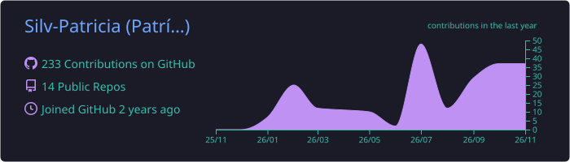

  

  

  

Sou estudante de **Sistemas de Informação** no **IFMG - Campus São João Evangelista**. Este GitHub funciona como um registro da minha trajetória acadêmica e profissional, onde centralizo meus projetos de faculdade e estudos de programação.

🎯 **Foco atual:** Aprimoramento em desenvolvimento Mobile (Flutter) e novos desafios acadêmicos.

<h3 align="left">Tecnologias</h3>

 

<picture>
  <source media="(prefers-color-scheme: light)" srcset="https://raw.githubusercontent.com/tandpfun/skill-icons/main/icons/VSCode-Light.svg">
  
</picture>

<picture>
  <source media="(prefers-color-scheme: light)" srcset="https://raw.githubusercontent.com/tandpfun/skill-icons/main/icons/CPP.svg">
  
</picture>

<picture>
  <source media="(prefers-color-scheme: light)" srcset="https://raw.githubusercontent.com/tandpfun/skill-icons/main/icons/MySQL-Light.svg">
  
</picture>

<picture>
  <source media="(prefers-color-scheme: light)" srcset="https://raw.githubusercontent.com/tandpfun/skill-icons/main/icons/Github-Light.svg">
  
</picture>

<picture>
  <source media="(prefers-color-scheme: light)" srcset="https://raw.githubusercontent.com/tandpfun/skill-icons/main/icons/Git.svg">
  
</picture>

<picture>
  <source media="(prefers-color-scheme: light)" srcset="https://cdn.jsdelivr.net/gh/devicons/devicon@latest/icons/inkscape/inkscape-original-wordmark.svg>
  
</picture>

<picture>
  <source media="(prefers-color-scheme: light)" srcset="https://raw.githubusercontent.com/tandpfun/skill-icons/main/icons/Flutter-Light.svg">
  
</picture>

<picture>
  <source media="(prefers-color-scheme: light)" srcset="https://raw.githubusercontent.com/tandpfun/skill-icons/main/icons/Dart-Light.svg">
  
</picture>

<picture>
  <source media="(prefers-color-scheme: light)" srcset="https://raw.githubusercontent.com/tandpfun/skill-icons/main/icons/Supabase-Light.svg">
  
</picture>

 
 

<h3 align="left">Linguagens e Estatísticas</h3>

  
  &nbsp;&nbsp;
  

 

---

### 📑 Informações Profissionais e Acadêmicas

* 🎓 **Técnica em Informática**.
* 🎓 **Estudante de Sistemas de Informação**.
* 🏢 **Experiência:** Atuei na **OneBit**, a empresa júnior do curso de Sistemas de Informação do IFMG-SJE.
* 📜 **Currículo Lattes:** [Acesse aqui meu Lattes](http://lattes.cnpq.br/6401161845517942)

---

### 🌐 Vamos nos conectar?

<picture>
  <source media="(prefers-color-scheme: dark)" srcset="https://raw.githubusercontent.com/Silv-Patricia/Silv-Patricia/output/github-contribution-grid-snake-dark.svg">
  <source media="(prefers-color-scheme: light)" srcset="https://raw.githubusercontent.com/Silv-Patricia/Silv-Patricia/output/github-contribution-grid-snake.svg">
  
</picture>

